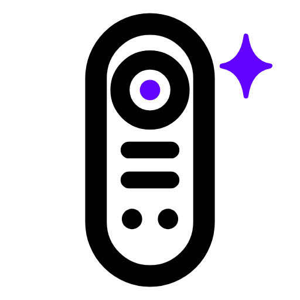

<p align="center">
  <picture>
    <source media="(prefers-color-scheme: dark)" srcset="brand/dark_icon@2x.png">
    
  </picture>
</p>

<h1 align="center">UC Remote MCP</h1>

<p align="center"><b>Set up and control your Unfolded Circle remote by just asking.</b></p>

<p align="center">
  <a href="https://modelcontextprotocol.io"></a>
  <a href="https://ko-fi.com/goobis2dmx"></a>
</p>

An MCP server for the **Remote 3 / Remote Two**. Works with Claude and any other MCP client.

## What it does

- **Layouts:** build an activity, device or page.
- **Buttons:** ask what a button does, or remap it.
- **Integrations:** install, set up and restart them.
- **Backups:** snapshot your config, see what changed, restore it.
- **Updates:** keep the remote current.

## Installation

1. **Install [uv](https://docs.astral.sh/uv/getting-started/installation/).** You already have it if you use another Python MCP server.

   ```powershell
   powershell -ExecutionPolicy ByPass -c "irm https://astral.sh/uv/install.ps1 | iex"   # Windows
   ```
   ```sh
   curl -LsSf https://astral.sh/uv/install.sh | sh                                    # macOS / Linux
   ```

2. **Add it to your MCP client.** For Claude Desktop, edit `%APPDATA%\Claude\claude_desktop_config.json` (Windows) or `~/Library/Application Support/Claude/claude_desktop_config.json` (macOS):

   ```json
   {
     "mcpServers": {
       "uc-remote": {
         "command": "uvx",
         "args": ["--from", "git+https://github.com/b2dmx/uc-remote-mcp@v1.0.0", "uc-remote-mcp"]
       }
     }
   }
   ```

3. **Restart the client.** First launch takes a minute while it builds.

## Onboarding

1. On the remote: **Settings → Web Configurator**, turn it on and note the PIN.
2. Tell your AI: *"Discover my Unfolded Circle remote and set it up with PIN 1234."*
3. Try: *"What does the volume button do in each activity?"*

## Tips

- Every change previews first and takes a backup, so it's safe to experiment.
- Say *"Back up my config"* before big changes, and *"What changed since that backup?"* after.
- Removing an entity also strips the buttons and page items using it.
- A stopped device? *"Restart the Apple TV integration."*
- To update, change the version in your config and restart. **Watch → Custom → Releases** to hear about new ones.
- Tested on a Remote 3 (firmware 2.8.x). The Remote Two shares the API but is untested.

## More

[All the tools →](docs/tools.md) · [Field notes →](docs/notes.md)

Tool design informed by [ha-mcp](https://pypi.org/project/ha-mcp/). API reference from the [Unfolded Circle Core API](https://github.com/unfoldedcircle/core-api).

---

<p align="center">
  <a href="LICENSE">MIT</a> · <a href="https://ko-fi.com/goobis2dmx">Support on Ko-fi</a> · Not affiliated with Unfolded Circle<br><br>
  UC Remote MCP v1.0.0 by Goobis<br>
  AI was used to help develop this application
</p>
